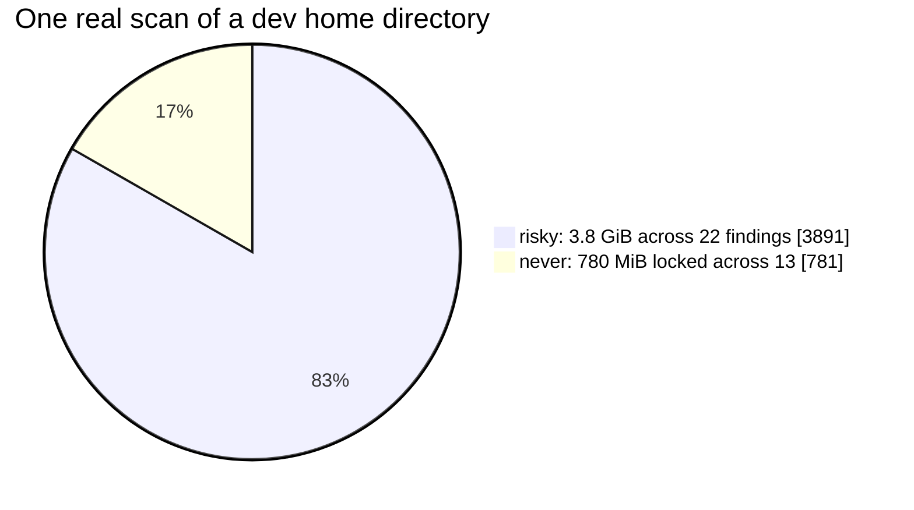
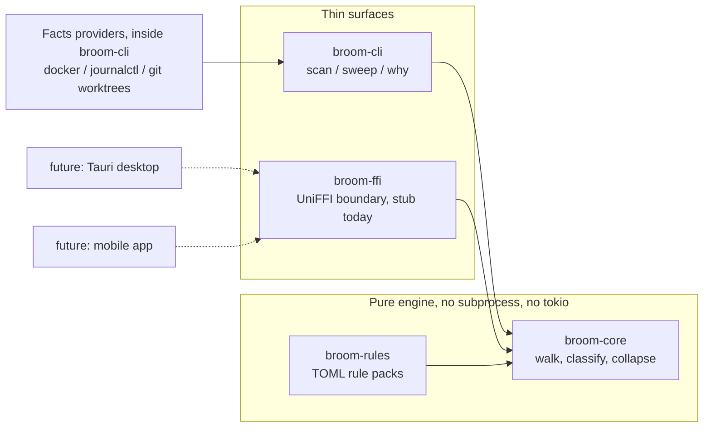
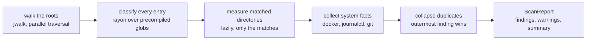
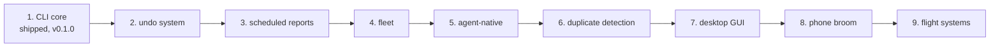

# OmniBroom

OmniBroom classifies disk findings as `safe`, `risky`, or `never`, and gives the reason for every verdict. ncdu tells you what is big. OmniBroom tells you what happens if you delete it.

v0.1.0, Rung 1 of 9. Runs on Linux today. The engine is built to run anywhere.

## The idea

Every cleanup tool sorts by size and lets you guess, or you need to export it to an AI. OmniBroom solves it by answering a different question: not "what is big" but "what is rebuildable and safe to delete".

Three verdicts:

- safe: deleting costs nothing of value. Caches and rebuildable artifacts.
- risky: verify before you sweep. Worktrees, orphaned volumes.
- never: deleting by hand loses data. Journal logs, SQLite WAL sidecars.

Every finding carries the rule that fired plus a sentence explaining itself. A rule that cannot explain itself does not exist here: the pack loader rejects it at startup.

Deletion is opt-in twice. `sweep` is a dry run by default, and real deletion needs `--yes`.

## See it work

### Scan a directory

```console
$ omnibroom scan ~/projects/omnirise/oss/omnibroom/app
╭─────────┬───────────┬──────────┬─────────────────────────────────────────────────────┬────────────────────────────────────────────╮
│ verdict ┆      size ┆ category ┆ path                                                ┆ reason                                     │
╞═════════╪═══════════╪══════════╪═════════════════════════════════════════════════════╪════════════════════════════════════════════╡
│ ● never ┆ 757.2 MiB ┆ system   ┆ /var/log/journal                                    │ Journal logs are the machine's memory of…  │
├╌╌╌╌╌╌╌╌╌┼╌╌╌╌╌╌╌╌╌╌╌┼╌╌╌╌╌╌╌╌╌╌┼╌╌╌╌╌╌╌╌╌╌╌╌╌╌╌╌╌╌╌╌╌╌╌╌╌╌╌╌╌╌╌╌╌╌╌╌╌╌╌╌╌╌╌╌╌╌╌╌╌╌╌╌╌┼╌╌╌╌╌╌╌╌╌╌╌╌╌╌╌╌╌╌╌╌╌╌╌╌╌╌╌╌╌╌╌╌╌╌╌╌╌╌╌╌╌╌╌╌┤
│ ● risky ┆         - ┆ docker   ┆ docker://volume/linkbreeze-bot_linkbreeze-bot-data  │ An orphaned volume is referenced by no…    │
╰─────────┴───────────┴──────────┴─────────────────────────────────────────────────────┴────────────────────────────────────────────╯

2 findings: 0 safe (0 B reclaimable), 1 risky, 1 never (757.2 MiB locked). 1489 entries scanned.

  safe  ░░░░░░░░░░░░░░░░░░░░░░░░   0 · 0 B
  risky ░░░░░░░░░░░░░░░░░░░░░░░░   1 · 0 B
  never ████████████████████████   1 · 757.2 MiB locked
```

The docker finding never touched the filesystem, and neither finding sits under the scanned folder: path rules respect the roots you pass, but fact providers observe the whole machine. The tool tells you the 757 MiB journal exists even when you only asked about one project. On a wider scan of the same machine, the byte split looks like this:



Zero safe bytes on a dev machine sounds backwards. It is not: every `node_modules` here sits inside a checked-out git worktree, so the node rules correctly refuse to call it safe.

### Ask why

```console
$ omnibroom why /var/log/journal
path: /var/log/journal
exists: yes
inside git worktree: no
verdict: never
╭─────────┬──────────────────────┬──────────┬──────────────────┬───────────────────────────────────────────────────╮
│ verdict ┆ rule                 ┆ category ┆ via              ┆ reason                                            │
╞═════════╪══════════════════════╪══════════╪══════════════════╪═══════════════════════════════════════════════════╡
│ ● never ┆ system.journal-logs  ┆ system   ┆ filesystem       ┆ Journal logs are the machine's memory of crashes, │
│         ┆                      ┆          ┆                  ┆ failed services, and…                             │
├╌╌╌╌╌╌╌╌╌┼╌╌╌╌╌╌╌╌╌╌╌╌╌╌╌╌╌╌╌╌╌╌┼╌╌╌╌╌╌╌╌╌╌┼╌╌╌╌╌╌╌╌╌╌╌╌╌╌╌╌╌╌┼╌╌╌╌╌╌╌╌╌╌╌╌╌╌╌╌╌╌╌╌╌╌╌╌╌╌╌╌╌╌╌╌╌╌╌╌╌╌╌╌╌╌╌╌╌╌╌╌╌╌╌┤
│ ● never ┆ system.journal-usage ┆ system   ┆ facts:journalctl ┆ Journal logs are the machine's memory of crashes, │
│         ┆                      ┆          ┆                  ┆ failed services, and…                             │
╰─────────┴──────────────────────┴──────────┴──────────────────┴───────────────────────────────────────────────────╯
```

`why` costs an ancestor check, not a scan. It shows every rule that claims the path, not just the winner.

### Sweep without fear

```console
$ omnibroom sweep ~/projects/omnirise/oss/omnibroom/app
No safe findings under the given paths.
DRY RUN: nothing was deleted. Re-run with --yes to delete the 0 safe finding(s) above (0 B).
```

`--yes` is the only way anything gets deleted. Without it the command is a rehearsal.

### Machine-readable output

```console
$ omnibroom scan ~/projects/omnirise/oss/omnibroom/app --json --top 1
```

```json
{
  "roots": [
    "/home/manak/projects/omnirise/oss/omnibroom/app"
  ],
  "findings": [
    {
      "path": "/var/log/journal",
      "verdict": "never",
      "category": "system",
      "reason": "Journal logs are the machine's memory of crashes, failed services, and boot history. Deleting them by hand destroys the one record you need during an outage; journalctl --vacuum-size manages retention safely.",
      "rule_id": "system.journal-usage",
      "size_bytes": 794191462,
      "origin": "facts:journalctl"
    },
    {
      "path": "docker://volume/linkbreeze-bot_linkbreeze-bot-data",
      "verdict": "risky",
      "category": "docker",
      "reason": "An orphaned volume is referenced by no running container, but volumes exist to hold data someone decided to keep. Check what is inside before pruning it.",
      "rule_id": "docker.orphaned-volume",
      "size_bytes": null,
      "origin": "facts:docker"
    }
  ],
  "warnings": [],
  "entries_visited": 3075,
  "summary": {
    "findings": 2,
    "safe": 0,
    "risky": 1,
    "never": 1,
    "reclaimable_bytes": 0,
    "risky_bytes": 0,
    "never_bytes": 794191462
  }
}
```

JSON output is the contract for everything that comes after the CLI: scheduled reports, a GUI, agents. For now, the output stays in the terminal because the priority is validating a stable, machine-readable format; it can be piped, redirected to a file, or consumed by future integrations without changing the interface.

## Architecture

One pure core, thin surfaces around it, rules as data.



The constraint that shapes everything: broom-core never runs a subprocess and never hardcodes a rule. The engine knows nothing about docker or journalctl. The CLI shells out to those tools, turns what they say into `Fact` values, and injects them. Rule packs are TOML files compiled at load, so adding support for a new kind of junk is a data change, not a code change. When a desktop GUI or a phone app arrives, it plugs into the same core through broom-ffi instead of forking the logic.

## How a scan runs



Three properties worth pointing at:

1. Sizes are measured only for subtrees that matched a rule. A scan over 397,053 entries still finishes fast because most directories are never measured.
2. Facts are best effort. Docker daemon down, journalctl missing, an unreadable directory: each becomes a warning in the report. A broken docker never hides the node findings.
3. When two rules claim one path, the more severe verdict wins, and a finding inside another finding's directory collapses into the parent. Summary bytes stay honest.

## The stack

| Crate | Job | Why this one |
|---|---|---|
| jwalk | directory traversal | Parallel walk out of the box, sorted entries for stable output |
| rayon | data parallelism | Same mental model as jwalk: classify entries across all cores with one `.par_iter()` |
| clap | CLI parsing | Derive-based subcommands, `scan` / `sweep` / `why` come straight from an enum |
| serde + toml + serde_json | serialization | Rule packs deserialize from TOML, reports serialize to JSON, one derive covers both |
| globset | pattern matching | Precompiled glob sets, which is what makes per-entry classification cheap |
| comfy-table | terminal tables | The rounded verdict tables, with cell width control for long reasons |
| thiserror + anyhow | errors | Typed errors in the core libraries, ergonomic errors at the CLI edge |
| dirs | platform paths | Knows where state belongs on Linux, macOS, Windows; ready for the undo system |
| tempfile + insta | testing | Fixture directories and snapshot tests: output changes are reviewed as diffs |

## Decisions worth defending

**Rules are data, never code.** All sixteen rules live in four TOML packs. The schema forces every rule to carry a non-empty reason, checked at load time. Classification fixes happen in a pack plus a regression test, never inside the engine.

**The core stays pure.** No subprocess calls, no async runtime, no IO surprises inside broom-core. Every system observation arrives through an injected trait. That is what lets the same core serve a CLI today and a phone later.

**Most severe verdict wins.** If any rule says `never`, the path is `never`. When rules disagree, the tool collapses toward caution.

**Dry run is the default.** Deletion needs an explicit `--yes`. The tool's whole pitch is consequences, so the destructive path is the guarded one.

## Where it goes



One release, one rung. Undo is next and closes the v1 fence: sweeps stage into the platform state directory for 7 days before the backup ages out.

## Build and install

You need a Rust toolchain (1.85 or newer) via [rustup](https://rustup.rs).

```console
$ cargo install --path crates/broom-cli
$ omnibroom --version
omnibroom 0.1.0
```

Platform notes:

- Linux is the verified platform. Rule packs cover Docker, node and npm caches, git worktrees, journal logs, and /tmp.
- macOS and Windows: the engine is cross-platform but has not been exercised there yet. On Windows the journalctl and /tmp rules have nothing to match and stay quiet; everything else behaves the same.
